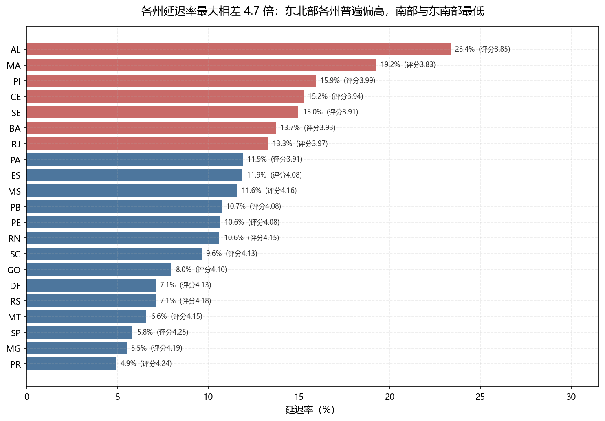
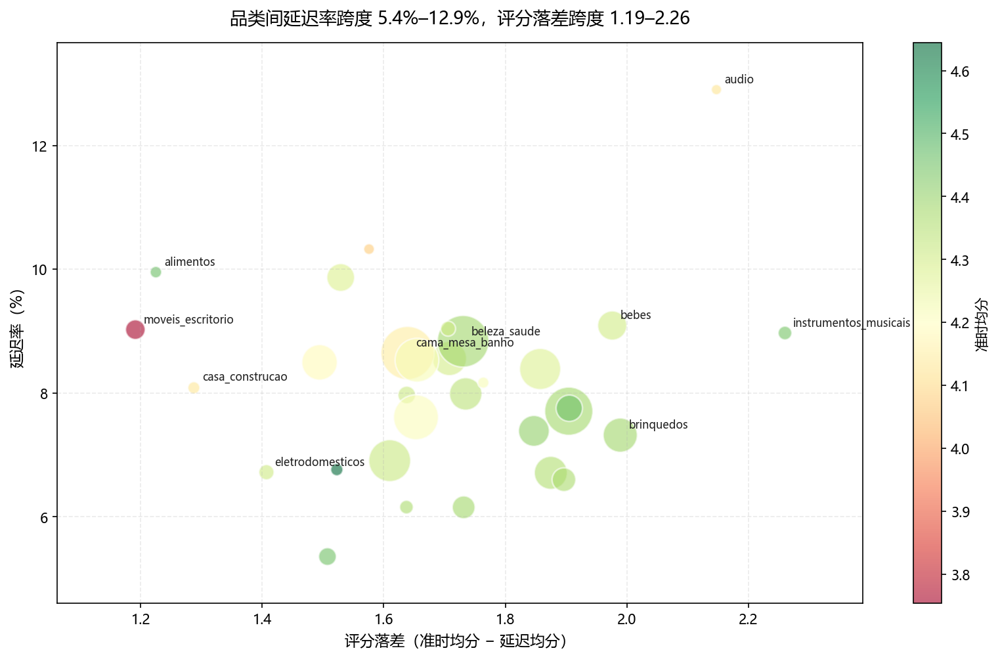
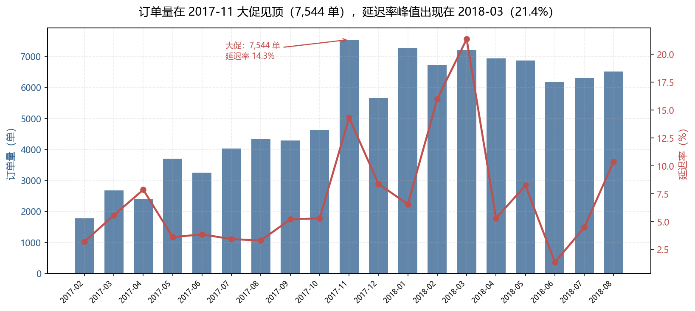
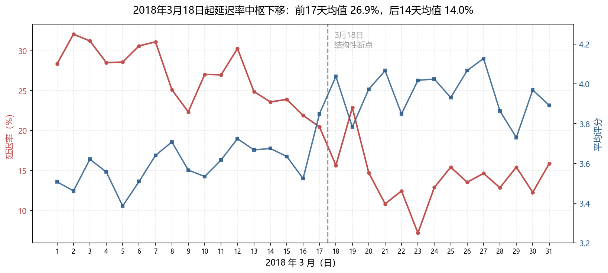
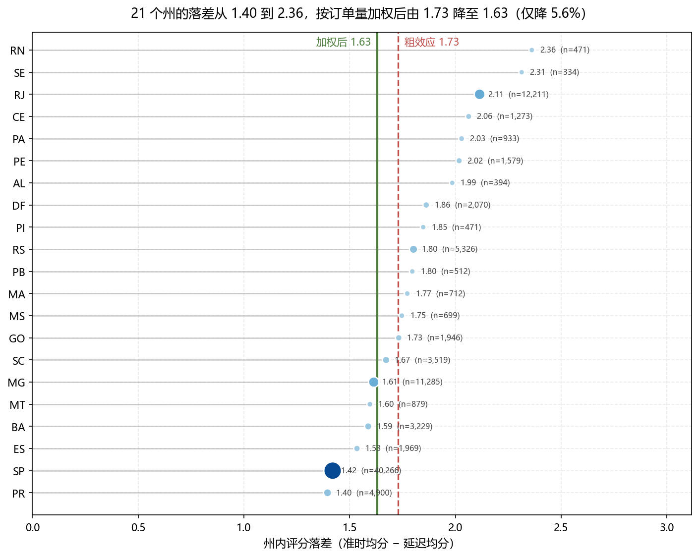
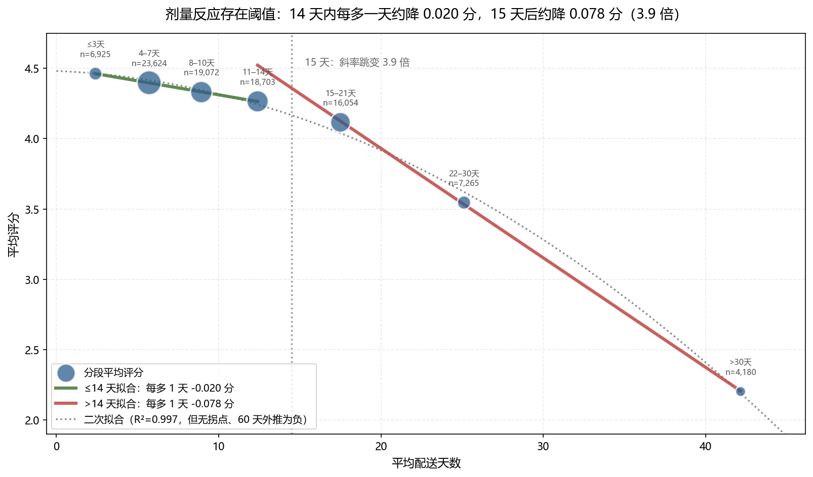
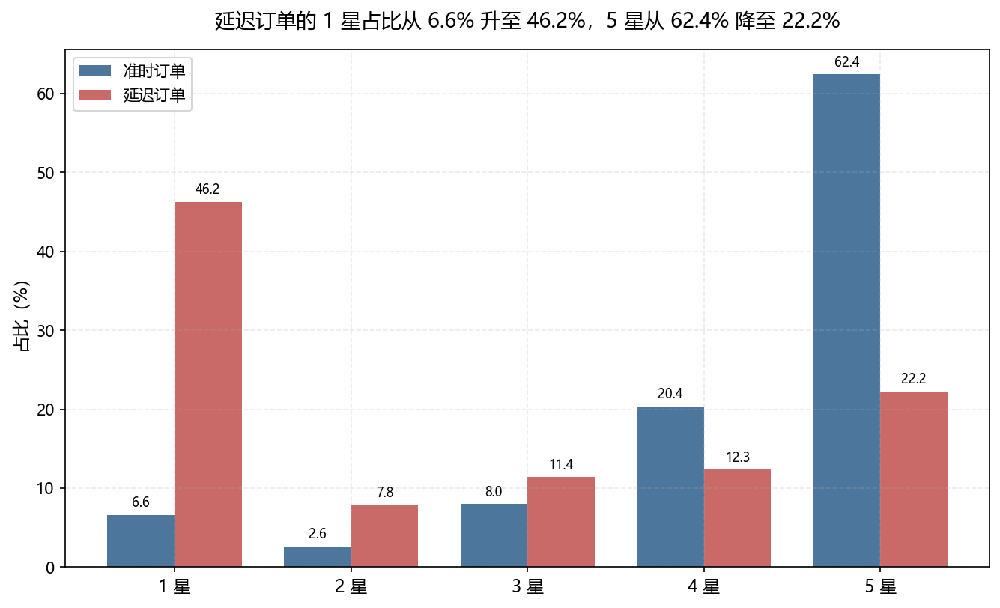
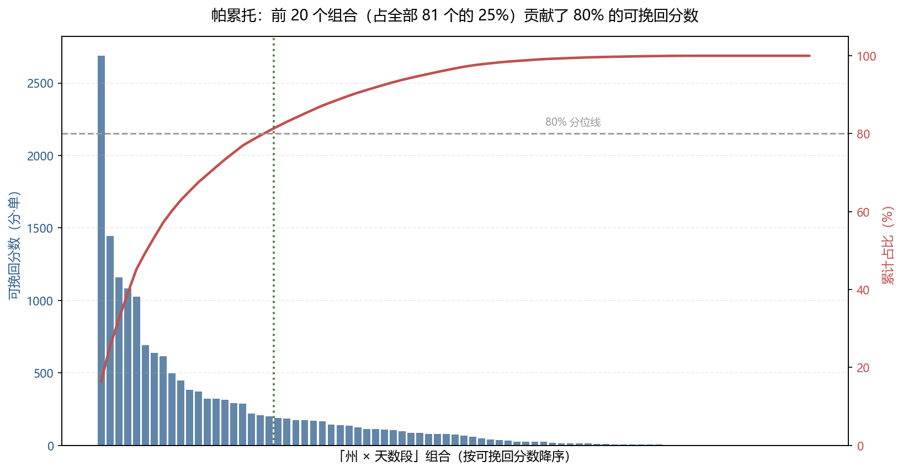
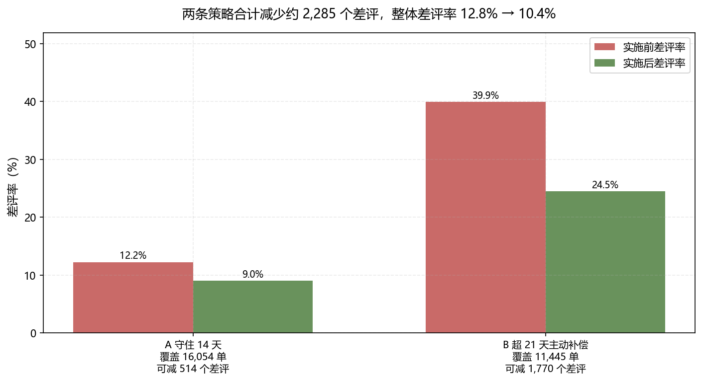

# 配送延迟如何影响用户满意度

## —— 基于 Olist 电商平台 9.9 万笔订单的因果分析

---

## 摘要

本文使用巴西电商平台 Olist 2016 年 9 月至 2018 年 10 月的 99,441 笔订单，考察配送延迟对用户评分的影响，并分离其中由地区差异造成的部分。

1. 延迟订单的平均评分比准时订单低 1.73 分。按订单量对 21 个州分层加权后，落差降至 1.63 分，降幅 5.6%；在个体数据上加入州、品类、金额、分期、月份等控制变量后，估计值为 1.67 分（95%CI −1.703 ~ −1.627）。三种方法的结论基本一致，地区构成不是主要的混杂来源。

2. 配送天数与评分之间呈阈值关系。14 天以内，每多一天评分下降 0.020 分；14 天以后每多一天下降 0.078 分，斜率为前者的 3.9 倍。在个体数据上加入阈值交互项后，超出部分的额外斜率为 −0.023 分/天（p < 0.001）。

3. 损失集中在少数环节。配送超过 14 天的订单占 28.7%，贡献了大部分差评。81 个「州 × 天数段」组合中，前 20 个（25%）合计占 80% 的可挽回分数；RJ 与 SP 两州合计占 48%。

4. 据此提出两条策略，合计可减少约 2,285 个差评，整体差评率由 12.8% 降至 10.4%。

---

## 1. 业务背景与问题定义

### 1.1 业务背景

Olist 是巴西的一家电商平台，为中小卖家提供统一的销售与物流履约服务。平台在 2016 至 2018 年扩张较快，月订单量从不足千单增长到 6,500 单以上。

规模扩大的同时，评价表现出现波动。以全部有评价的订单为分母，平台差评率（≤2 星）为 14.7%，其中 1 星评价占全部评价的 11.5%。

这 14.7% 的差评中，有 15.3% 来自未送达订单。这类订单（取消、缺货、超期未签收）共 2,849 笔，差评率 78.0%，平均分 1.75。

本文的分析对象是已送达且有评价的 95,824 笔订单，该样本差评率 12.8%。限定在这一范围的原因是，「是否延迟」只能在已送达订单上定义。因此本文估计的是货物送达之后，延误若干天所带来的评分损失，不涉及「未送达」这一类失败。后者成因不同（缺货、丢件、取消），需要单独的分析框架，本文不做外推。

### 1.2 问题的提出

平台内部对差评的归因存在两种看法：

- 运营侧认为差评主要来自物流延误，主张加大物流投入；
- 区域侧认为差评集中在东北部各州，属于区域经济与客户结构问题，与物流关系不大。

两种看法对应的资源投向不同。判断的前提是回答三个递进的问题：

1. 延迟与差评之间是否存在关系；
2. 这一关系有多少来自地区差异；
3. 延迟到何种程度开始产生明显影响。

本文依次处理这三个问题。

### 1.3 分析窗口

原始数据覆盖 2016-09 至 2018-10，首尾月份不完整：

- 2016 年 9 至 12 月月订单量低于 400 单，属于平台试运营期；
- 2018 年 9 至 10 月数据被截断，分别为 16 单和 4 单。

分析窗口取 2017-02 至 2018-08，共 19 个完整月，判据为当月延迟订单数不少于 30 单，以保证延迟组均值有足够样本。2016-11 整月没有订单记录，该缺口落在窗口之外，不影响分析。

---

## 2. 数据与方法

### 2.1 数据来源

Olist 公开电商数据集（Brazilian E-Commerce Public Dataset），包含 9 张表：

| 表 | 行数 | 粒度 |
|---|---|---|
| orders | 99,441 | 一行一订单 |
| order_items | 112,650 | 一行一订单商品 |
| order_payments | 103,886 | 一行一次支付 |
| order_reviews | 99,224 | 一行一条评价 |
| customers | 99,441 | 一行一客户编号 |
| products | 32,951 | 一行一商品 |
| sellers | 3,095 | 一行一卖家 |
| geolocation | 1,000,163 | 一行一邮编 |

### 2.2 宽表构建

分析粒度取订单，将 6 张明细表对齐到订单粒度，构建 41 字段宽表。三个处理需要注意：

（1）明细表先聚合再关联。`order_items` 是一单多行的粒度，直接关联会使订单表从 99,441 行膨胀到 113,425 行，同一订单的商品金额被重复累加。处理方式是用 `GROUP BY order_id` 压回订单粒度后再 `LEFT JOIN`。

（2）一人多单时使用正确的客户主键。客户表有两个编号：`customer_id` 每单唯一，共 99,441 个值；`customer_unique_id` 代表真实的人，共 96,096 个值。客户维度的计算使用后者。

（3）多值字段确定取值规则。一单涉及多个品类时取金额最大者为主品类；一单多次支付时取金额最大的支付方式；一单多条评价时取最新一条。

### 2.3 指标口径

| 指标 | 定义 |
|---|---|
| 延迟率 | 已送达订单中，实际签收时间晚于承诺送达时间的比例 |
| `is_late` | 迟到取 1，准时取 0，未送达取 NULL，不参与延迟率计算 |
| 配送天数 | 下单时间至签收时间的天数 |
| 差评率（平台口径） | 差评订单数 ÷ 全部有评价的订单数 = 14.7% |
| 差评率（分析口径） | 差评订单数 ÷ 已送达且有评价的订单数 = 12.8% |
| 差评 | 评分不高于 2 星 |
| 平均送达时长 | 12.1 天，中位数 10 天；延迟率 8.1% |

两个差评率口径相差 1.9 个百分点，差额全部来自未送达订单。涉及平台整体表现的表述使用平台口径，涉及延迟影响的统计使用分析口径，并在正文中注明。

关于 `is_late` 取 NULL 而非 0：未送达订单无法判断是否延迟。若记为 0，等于把未知状态当作已确认准时，延迟率的分母会从 96,470 扩大到 99,441，延迟率被稀释至 7.9%，同时 2,971 笔未送达订单会从异常分析中消失。

### 2.4 分析方法

| 步骤 | 方法 | 目的 |
|---|---|---|
| 混杂控制 | 分层加权（直接标准化） | 控制地区构成 |
| 混杂控制 | 多元回归与固定效应 | 控制多维变量 |
| 阈值识别 | 分箱均值与阈值交互项回归 | 定位拐点 |
| 平衡性检验 | 协变量组间对比 | 判断两组可比性 |
| 稳健性 | 更换结局变量 | 结论是否依赖评分刻度 |

---

## 3. 现状

### 3.1 地区维度

27 个州中，延迟率最低为 4.9%（PR），最高为 23.4%（AL），相差约 5 倍。



东北部各州（AL、MA、PI、CE、SE、BA）普遍偏高，南部与东南部最低。平均评分与延迟率呈反向关系：延迟率最高的 AL 评分最低，为 3.85；延迟率最低的 PR 评分最高，为 4.24。

### 3.2 品类维度

32 个品类的延迟率跨度是 5.4% 至 12.9%，相差 2.3 倍。



品类维度有一处与直觉不符的地方：延迟率高并不等于伤害大。`audio` 延迟率 12.9%、评分落差 2.14，而 `alimentos`（食品）延迟率 10.0%、落差只有 1.23。货物是否容易延误，与延误造成的评分损失，两者并不一致。

地区维度的解释力约为品类的两倍，因此后续分析以地区作为主要控制变量。

### 3.3 时间维度

延迟率在 19 个月中从 1.4% 波动到 21.4%，没有平滑趋势。



- 2017-11：订单量增加 63%，达到 7,544 单，延迟率同步升至 14.3%，与大促带来的履约压力一致；
- 2018-03：延迟率 21.4%，为全窗口最高；
- 2018-06：延迟率 1.4%，为全窗口最低。

2018 年 3 月的逐日数据显示，该月内部存在结构性断点：



3 月 1 日至 17 日延迟率均值 26.9%，3 月 18 日之后降至 14.0%。拆分到州后，11 个主要州全部同步下降，平均降幅 15 个百分点，说明这是一次全国性运营中断的修复过程，而非局部故障。

---

## 4. 混杂控制

### 4.1 问题

直接比较所有延迟订单与所有准时订单，落差为 1.73 分。这一数值可能受地区差异影响：东北部各州延迟多、评分也低，不加控制时容易把地区差异误判为延迟的影响。

### 4.2 分层加权

对 21 个主要州（总订单不少于 300 且延迟订单不少于 30）分别计算州内落差，再按订单量加权：

> 加权落差 = Σ（各州订单量 × 各州落差）÷ Σ 各州订单量



三个数值含义不同，容易混淆：

| 算法 | 结果 | 说明 |
|---|---|---|
| 21 州简单平均 | 1.82 | 471 单的州与 40,266 单的州等权，不宜采用 |
| 粗效应（全部订单） | 1.73 | 受延迟组在各州的构成影响 |
| 分层加权 | 1.63 | 采用此值 |

SP 州占全国 42% 的订单，落差为 1.42，处于最低一档，对加权均值形成下拉。粗效应偏高则是因为高延迟率州在延迟组中占比更大，属于构成效应。

控制地区后，落差由 1.73 降至 1.63，降幅 5.6%，地区不是主要的混杂来源。

### 4.3 平衡性检验

若两组在订单结构上差异较大，说明订单本身的问题可能同时影响配送与评价。检验结果如下：

| 特征 | 准时组 | 延迟组 | 差异 |
|---|---|---|---|
| 样本量 | 88,644 | 7,826 | — |
| 商品件数 | 1.14 | 1.11 | 接近 0 |
| 卖家数 | 1.01 | 1.00 | 接近 0 |
| 最大分期 | 2.92 | 3.01 | 接近 0 |
| 客单价 | 158.7 | 172.7 | +8.8% |
| 有评分比例 | 99.5% | 97.9% | 差约 4 倍 |

前四项基本一致，两组在订单结构上可比。客单价相差 8.8%，不足以解释 1.63 分的落差。

有评分比例这一项需要单独说明。延迟订单的评价缺失率是准时订单的四倍，缺失并非随机，不满程度较高的客户可能直接放弃评价。这意味着本文的估计存在低估的可能，方向是低估而非高估。

---

## 5. 剂量反应

### 5.1 分箱结果

将配送天数分为 7 段：

| 天数段 | 订单数 | 平均评分 | 差评率 |
|---|---|---|---|
| ≤3 | 6,925 | 4.463 | 7.0% |
| 4–7 | 23,624 | 4.398 | 7.7% |
| 8–10 | 19,072 | 4.331 | 8.7% |
| 11–14 | 18,703 | 4.265 | 9.5% |
| 15–21 | 16,054 | 4.116 | 12.2% |
| 22–30 | 7,265 | 3.546 | 25.8% |
| >30 | 4,180 | 2.203 | 64.5% |



相邻两段的斜率：

```
−0.0198   −0.0207   −0.0189   −0.0292   −0.0749   −0.0788
                           ↑          ↑
                        斜率上升    趋于平缓
```

前四段斜率非常接近，落在 −0.019 至 −0.021 之间；第五段升至 −0.075，约为前者的 3.9 倍。

### 5.2 函数形式的选择

二次函数对这 7 个点的拟合优度为 R² = 0.997，高于分段线性，但不适用于本文的分析目的：

| 问题 | 说明 |
|---|---|
| 参数偏多 | 7 个点拟合 3 个参数，R² 偏高缺少信息量 |
| 曲率恒定 | 隐含伤害加速递增，而实测 25 天之后已趋平（−0.0749 至 −0.0788） |
| 外推失效 | 外推至 60 天预测评分为 −0.04，低于 1 分的取值下限 |
| 无拐点 | 无法回答「应控制在几天以内」这一业务问题 |

图 8 中保留二次拟合作为灰色参照线，用于说明结论不依赖人为分段。正文以分段线性为准。

### 5.3 阈值效应的检验

在个体数据上估计，不采用分组均值：

> 评分 = α + β₁ × 配送天数 + β₂ × max(配送天数 − 14, 0) + γ × 控制变量 + ε

β₂ 衡量超过 14 天之后每多一天的额外影响。

| 参数 | 估计值 | p 值 |
|---|---|---|
| β₁（14 天内斜率） | −0.0308 | < 0.001 |
| β₂（超出部分的额外斜率） | −0.0233 | 2.8×10⁻¹⁴ |
| β₁+β₂（超出部分总斜率） | −0.0541 | — |
| 斜率变化倍数 | 1.76 倍 | — |

交互项显著为负，阈值效应在统计上成立。

### 5.4 拐点位置的识别精度

将拐点依次设为 7、10、12、14、16、18、21、25、30 天，各模型 R² 在 0.1273 至 0.1295 之间，差异很小。

数据本身无法精确识别拐点位置，10 至 16 天这一区间在统计上难以区分。业务上取 14 天，理由有两点：该值位于统计上不可区分的区间内；且对应「两周」这一客户心理上的整数关口。

分箱斜率倍数（3.9）高于个体回归（1.76），原因是分箱对样本量 4,180 的 >30 天段与 23,624 单的 4–7 天段等权处理，放大了极端段的斜率。正式估计以个体回归为准，分箱结果仅用于描述形态。

---

## 6. 验证与稳健性

### 6.1 回归调整

以评分为因变量，逐步加入控制变量：

| 模型 | 延迟系数 | 95% 置信区间 | R² |
|---|---|---|---|
| 仅延迟（无控制） | −1.729 | — | 0.133 |
| 含州、品类、金额、分期、月份 | −1.665 | [−1.703, −1.627] | 0.149 |

分层加权给出 1.63，回归调整给出 1.67，两者相差 0.04 分。两种原理不同的方法得到接近的结果，估计较为稳健。

### 6.2 更换结局变量

将连续评分替换为二元指标，检验结论是否依赖评分刻度：

| 结局变量 | 延迟系数 | 解释 |
|---|---|---|
| 差评率（≤2 星） | +0.435 | 延迟使差评率上升 43.5 个百分点 |
| 好评率（≥4 星） | −0.465 | 延迟使好评率下降 46.5 个百分点 |

方向与量级一致，结论不依赖评分刻度。

### 6.3 评分的分布变化



均值会掩盖结构变化。延迟订单中 46.2% 为 1 星，准时订单为 6.6%；5 星占比则从 62.4% 降至 22.2%。延迟带来的不是评分的小幅下滑，而是评价结构整体下移。

---

## 7. 策略建议

### 7.1 优先级

配送超过 14 天的订单共 27,499 笔，占 28.7%。按「州 × 天数段」拆分为 81 个组合：



前 20 个组合（25%）合计占 80% 的可挽回分数。单一最大组合是「RJ 州 × 超过 30 天」，1,080 笔订单，平均评分 1.78。

按州汇总，可挽回分数的分布较为集中：

| 州 | 超时订单 | 平均评分 | 可挽回分数 | 占比 |
|---|---|---|---|---|
| RJ | 4,532 | 3.33 | 4,219 | 25.8% |
| SP | 4,921 | 3.53 | 3,628 | 22.2% |
| MG | 2,822 | 3.73 | 1,512 | 9.2% |
| BA | 1,997 | 3.71 | 1,101 | 6.7% |
| RS | 2,205 | 3.90 | 795 | 4.9% |

RJ 与 SP 两州合计占 48%，与「问题集中在东北部」的印象不同。东北部各州延迟率虽高，订单基数较小；RJ 与 SP 是订单量最大的两个市场，延迟造成的绝对损失更大。

### 7.2 两条策略



### 策略 A：守住 14 天

- 目标人群：15 至 21 天段的 16,054 笔订单
- 动作：按时效分级，对承诺送达日临近 14 天的订单优先派发、优先中转
- 预期效果：该段差评率由 12.2% 降至 9.0%，减少约 514 个差评
- 衡量指标：15 至 21 天订单占比、该段差评率

### 策略 B：超过 21 天主动补偿

- 目标人群：22 天以上的 11,445 笔订单
- 动作：系统识别超 21 天未签收订单，触发主动沟通与运费券补偿。此类订单时效已无法挽回，只能改善体验
- 预期效果：按补偿挽回一半缺口估算，差评率由 39.9% 降至 24.5%，减少约 1,770 个差评
- 衡量指标：补偿触达率、补偿后 7 日内评分

两条策略合计减少约 2,285 个差评，整体差评率由 12.8% 降至 10.4%。

策略 B 中「挽回一半」这一系数没有数据支撑，属于经验假设，实际落地应通过 A/B 实验测定。

### 7.3 关于整体提速

若将全部超时订单压缩至 14 天以内，整体平均分可由 4.156 提升至 4.325，差评率降至 8.4%。这是理论上限，需要把 28.7% 的订单全部压缩到两周内，成本上不可行。

资源更宜集中投向帕累托曲线的前 25% 组合，即 RJ、SP 两地 22 天以上的订单，而非均匀提升全网时效。

---

## 8. 局限

1. 评价缺失非随机。延迟订单的评价缺失率为 2.1%，准时订单为 0.5%，相差约四倍。缺失可能集中于不满程度较高的用户，本文估计偏低估。

2. 观测数据而非随机实验。卖家质量、商品质量、地址准确性等因素可能同时影响配送时效与满意度，无法完全排除。

3. 拐点位置不确定。10 至 16 天在统计上不可区分，14 天是业务选择，不是数据的唯一解。

4. 数据时效性。数据截至 2018 年 10 月，未涵盖直播电商、即时零售等新业态，向当前业务迁移时需要重新验证。

5. 缺乏行业基准。8.1% 的延迟率没有可直接对标的行业数据，只能作为内部比较的起点。

6. 未覆盖未送达订单。分析样本限定在已送达订单，排除了 2,849 笔有评价的未送达订单。这类订单差评率 78.0%，占全部差评的 15.3%，但失败机制不同，需单独建模。本文结论不适用于这一类。

---

## 附录 A：代码结构

```
olist-growth-analysis/
├── check_data.py              数据完整性校验
├── 01_data_profile.py         数据摸底（字段字典）
├── 02_build_wide_table.py     宽表构建（DuckDB）
├── 03_load_to_mysql.py        导入 MySQL
├── 04_make_figures.py         图 1–8
├── 05_regression.py           回归、阈值检验、稳健性
├── 06_strategy_figures.py     图 9–10、策略量化
├── sql/
│   ├── 00_全流程.sql                完整分析 SQL（附录 C）
│   ├── 01_build_wide_table.sql      宽表 DDL（DuckDB 版）
│   ├── 01b_build_wide_table_mysql.sql  宽表 DDL（MySQL 版）
│   ├── 02_state.sql                 按州分析
│   ├── 03_stratified.sql            分层加权
│   └── 04_dose_response.sql         剂量反应分箱
├── report/figures/            10 张图
└── docs/                      字段字典、回归结果、策略量化
```

## 附录 B：宽表字段（节选）

| 字段 | 含义 |
|---|---|
| `order_id` | 订单主键（一单一行） |
| `customer_unique_id` | 客户唯一编号（代表真实的人） |
| `is_delivered` | 是否已送达 |
| `delivery_days` | 配送天数 |
| `delay_days` | 延迟天数（签收 − 承诺） |
| `is_late` | 是否延迟（未送达为 NULL） |
| `order_amount` | 订单总金额（商品 + 运费） |
| `main_category` | 主品类（金额最大者） |
| `review_score` | 评分（多评价取最新） |
| `is_low_score` | 差评（≤2 星） |
| `customer_total_orders` | 该客户累计下单数 |
